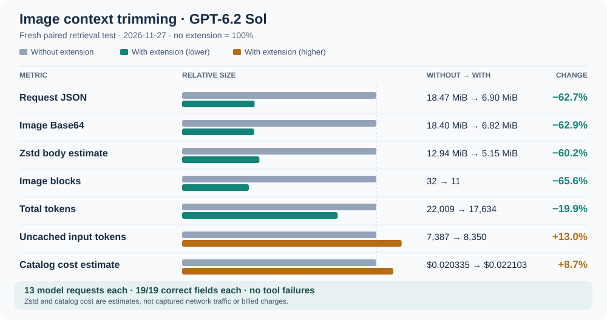

# pi-image-context-trimmer

English | [简体中文](README_zh.md)

Reduce repeated Base64 image uploads in Pi without discarding active visual evidence. Historical images become recoverable references when trimming is worthwhile.

## Installation

Current release: `0.4.0`.

```sh
pi install npm:pi-image-context-trimmer
```

Try the latest source without changing global settings:

```sh
git clone https://github.com/yoonshilee/pi-image-context-trimmer.git
cd pi-image-context-trimmer
npm ci --ignore-scripts
pi -e ./src/index.ts
```

Requires Pi with `context_with_system` (tested with 1.6.0). Supports vision-capable stateless `openai-completions`, `openai-responses`, and `anthropic-messages` APIs. SDK hosts explicitly using `openai-codex-responses` over SSE can load `pi => imageContext(pi, { codexTransport: "sse" })` through `extensionFactories`. Native incremental/WebSocket transports and sessions without the recall tool are bypassed. Core-only hosts must integrate the context transformation and image lookup from `src/image-context.ts` themselves.

## What it does

- **Preserve evidence:** keep distinct active-task images; deduplicate exact copies and replace eligible completed-task images with SHA-256 references. `recall_context_image` can restore the original from the current session branch.
- **Protect cache:** compare ordered content-block prefixes and estimated cache-rebuild costs with future read savings. Trim economical historical suffixes rather than rewriting every image at once, including when projected pricing tiers differ. Inspired by [SoL-Pi](https://github.com/NVlabs/SoL-Pi/blob/097fad0105181dd93003eb4948a0d649a550bfe2/src/sol-pi/extensions/online-context-compact/economics.ts).
- **Bound traffic:** enforce per-request and cumulative deferred-Base64 budgets; context-window pressure overrides deferral.
- **Coordinate compaction:** defer automatic threshold compaction when the trimmed context safely fits, without intercepting manual compaction or overflow recovery.

No external image storage, persistent history edits, or extra summarization requests are introduced. Single-image resizing remains Pi's responsibility (`inputLimits.images.resize`).

## Configuration & statistics

Defaults in `~/.pi/agent/image-context-trimmer.json` (or the configured Pi agent directory):

```json
{
  "enabled": true,
  "display": "summary",
  "cacheAware": true,
  "cacheHorizonRequests": 4,
  "maxDeferredBase64Bytes": 1048576,
  "maxCumulativeDeferredBase64Bytes": 4194304,
  "compactionGuard": true
}
```

`cacheAware: false` or a zero byte budget gives bandwidth-first trimming. The assumed horizon is not a forecast. The cumulative budget resets after eligible history is fully trimmed or the cache/session context changes; the statistics remain cumulative. SDK hosts may override `configPath`.

| Command | Effect |
|---|---|
| `/image-context-trimmer status` | Show cumulative statistics since load. |
| `/image-context-trimmer on` / `off` | Enable/disable trimming. |
| `/image-context-trimmer display summary` / `display off` | Enable/disable automatic task cards. |

Expand the native conversation card with `Ctrl+O` to inspect omitted bytes, image recalls, reported token usage/cache-read ratio, estimated break-even, deferred bytes, and compactions. Cards never enter the model context. Commands apply to the loaded session; they do not edit the config file.

## Validation

`npm run check` passes type checking and 54 unit and Pi SDK integration tests.

### Latest real-model comparison

GPT-6.2 Sol, 2026-11-27: a fresh on/off pair using the same four prompts, eight synthetic document images, exact-match scoring, and separate sessions with native compaction disabled. Both trials completed.



| Metric | Without extension | With extension | Change |
|---|---:|---:|---:|
| Request JSON | 18.47 MiB | 6.90 MiB | −62.7% |
| Base64 payload | 18.40 MiB | 6.82 MiB | −62.9% |
| Zstd body estimate | 12.94 MiB | 5.15 MiB | −60.2% |
| Image blocks | 32 | 11 | −65.6% |
| Reported total tokens | 22,009 | 17,634 | −19.9% |
| Uncached input tokens | 7,387 | 8,350 | +13.0% |
| Cache-read tokens | 14,208 | 8,832 | −37.8% |
| Output tokens | 414 | 452 | +9.2% |
| Observed elapsed time | 160.9 s | 108.2 s | −32.7% |
| Estimated catalog cost | $0.020335 | $0.022103 | +8.7% |
| Model requests | 13 | 13 | — |
| Correct fields | 19/19 | 19/19 | — |

Request JSON fell by **62.7%** and total tokens by **19.9%**, with the same accuracy and request count. Neither trial had tool failures; one recall replaced an ordinary read. Uncached input increased, so estimated catalog cost also increased. The estimate uses this run’s catalog rates ($2 input, $0.10 cached read, $10 output per million tokens), not billed cost. Zstd is recomputed at level 3; timing is a single observation. Both economic decisions trimmed rather than deferred; selective deferral and compaction are covered by the SDK checks below.

### Cache and compaction checks (local SDK)

Identical seven-request fixture with an early small image, long text, and a later large image:

| Policy | JSON bytes | Simulated input/cache cost |
|---|---:|---:|
| All-or-nothing / retain both | 1,254,477 | $0.033396 |
| Immediate trimming | 489,353 | $0.051823 |
| Selective trimming | **555,237** | **$0.033002** |

Selective trimming reduced JSON by **55.7%** versus all-or-nothing and simulated cost by **36.3%** versus immediate trimming. Separately, the compaction guard reduced two SDK requests to one by avoiding a redundant summary; budget enforcement and reattachment deduplication also passed.

JSON and Base64 are request-context measurements, not network captures. Estimated costs, simulated cache savings, and observed token usage are not billing guarantees. The original images remain in the session; re-examining a historical image may require recall.

[MIT](LICENSE).
