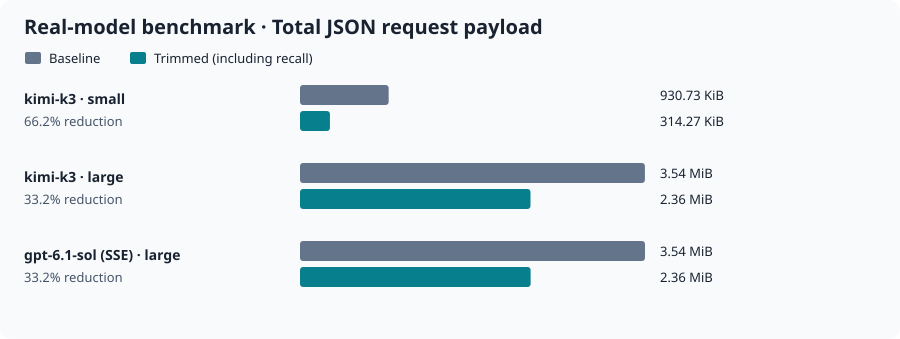

# pi-image-context-trimmer

English | [简体中文](README_zh.md)

A Pi extension that replaces historical images from completed turns with recoverable references, reducing repeated request payloads and bandwidth usage for stateless model APIs.

## Installation

Tested with Pi 1.6.0. By default, the extension targets vision-capable models using the `openai-completions` and `openai-responses` APIs.

```sh
pi install npm:pi-image-context-trimmer
```

Try the extension from source without modifying global settings:

```sh
git clone https://github.com/yoonshilee/pi-image-context-trimmer.git
cd pi-image-context-trimmer
npm ci --ignore-scripts
npm run check
pi -e ./src/index.ts
```

In Pi's interactive interface, use `/image-context-trimmer status` to view eligibility, replacement counts, and omitted Base64 bytes for the current session. Use `/image-context-trimmer off` to restore untrimmed requests and `/image-context-trimmer on` to enable trimming again.

SDK applications can load the extension through `DefaultResourceLoader` and its `additionalExtensionPaths` option. Codex SDK hosts that explicitly use `transport: "sse"` can enable trimming by passing `pi => imageContext(pi, { codexTransport: "sse" })` in `extensionFactories`; this must match the host's SSE configuration. The default CLI does not trim Codex's native `auto` or WebSocket transport. Trimming is disabled when tools are explicitly disabled or `recall_context_image` is unavailable. Applications using only `pi-agent-core`, without the `pi-coding-agent` extension host, must integrate the context transformation and image lookup in `src/image-context.ts` themselves.

## How it works

1. New user attachments and tool-result images visible on the current session branch are sent in Pi's original image format.
2. Once a subsequent model response or tool call completes successfully, later requests replace larger historical image blocks with short text containing a SHA-256 reference. New images are still sent; identical new images within a request need only be sent once.
3. When exact visual details are required, the model uses `recall_context_image`. The extension finds and returns the original image from the current session branch. The next model request includes the image, and subsequent requests use references again. Pi may still normalize tool-result images according to the current model's limits.
4. Original session messages remain unchanged. Images are retained when their source cannot be recovered, tools are disabled, or the model does not support images. At least one copy is retained until a new image has received a successful response. The extension bypasses native WebSocket incremental continuation and other unverified model interfaces.

No images are uploaded to external storage. The extension does not modify Pi's source code or session-file format, and it does not remove Base64 from persisted session files. Re-examining an older image may require an extra tool call, and changing the context prefix can affect prompt caching. The omitted-byte statistic counts Base64 characters in the context, not captured network traffic.

## Single-image size

Pi 1.6.0 supports limiting the resolution, encoded size, and JPEG quality of newly attached images through `inputLimits.images.resize` in a model's configuration or `modelOverrides` in `models.json`. For example, a model used on bandwidth-constrained connections can be configured as follows:

```json
{
  "inputLimits": {
    "images": {
      "resize": {
        "maxWidth": 1568,
        "maxHeight": 1568,
        "maxBytes": 524288,
        "jpegQuality": 75
      }
    }
  }
}
```

These are example values, not extension defaults. `maxBytes` measures the Base64-encoded size. Pi documents defaults of 2000 × 2000 pixels, 4.5 MiB encoded size, and JPEG quality 80. Resizing can reduce the legibility of text, screenshots, and charts; avoid applying aggressive limits globally without verifying the target visual task. Existing historical images are not automatically re-encoded by this setting.

## Local validation

`npm run check` runs type checking, pure-function tests, and Pi 1.6.0 SDK integration tests. The integration tests load the actual extension and receive Chat Completions requests through a local HTTP server without calling real models or external gateways. Additional tests use Pi's two compatible API serializers with a mock `fetch` to measure JSON request bodies for different simulated image sizes.

In a valid PNG scenario, the original three calls contained image counts of `[1, 1, 1]`. With trimming and no image recall, the counts were `[1, 0, 0]`. When recall was required, four calls (including one additional model call) contained `[1, 0, 1, 0]`. The original image remained in the session.

A simulated 1 MiB binary image encodes to approximately 1.33 MiB. Across three Chat Completions requests, the original serialized bodies were 1,398,298, 1,398,383, and 1,398,468 bytes. With trimming, they were 1,398,298, 456, and 541 bytes. This test excludes tool definitions and Pi's default system prompt; it is a local serialization test, not a measurement of real-model latency or billing.

## Real-model benchmarks (2026-11-27)

The following results cover three complete paired comparisons using `gpt-6.1-sol` and `kimi-k3`, plus one verification of GPT's native incremental transport.

### Method

- Two reproducible synthetic PNGs were used: `small` (480 × 290, 237,304 bytes) and `large` (960 × 600, 925,985 bytes). Each has a different four-digit number at the top and bottom, with a seeded random-noise background to vary payload size. Each pair uses the same image and questions across three turns: read the top number, answer a text-only arithmetic question, and read the bottom number from the original image.
- The baseline does not load the extension; the trimmed run loads the actual extension. Each starts with an empty session, the same model and prompts, and exact-match scoring against predetermined answers. The output limit is 512 tokens, thinking is off, and automatic retries, session compaction, and proactive cache warming are disabled.
- Payload size is the UTF-8 byte length of JSON serialized from Pi's `before_provider_request` event. It includes actual system prompts, tool definitions, and additional model requests, not captured TLS traffic. Elapsed time covers submission through completion of each user turn, including model, network, and recall-tool waits. Token counts are `totalTokens` recorded by Pi from model responses, not actual charges.
- The GPT SSE comparison uses isolated SDK sessions with `transport: "sse"` and explicit trimming, without changing global Pi settings. The default `auto` WebSocket path is tested separately. Its request hook may still expose the full candidate context, so its JSON size is not the actual WebSocket transmission size.
- Aggregate comparisons include only pairs in which both runs completed all three turns.

### Total request payload



| Model / image | Baseline | Trimmed | Reduction | Calls B/T | Time B/T | Correct B/T | Image recalls |
|---|---:|---:|---:|---:|---:|---:|---:|
| kimi-k3 / small | 930.73 KiB | 314.27 KiB | **66.2%** | 3/3 | 34.94/27.49 s | 3/3 · 3/3 | 0 |
| kimi-k3 / large | 3.54 MiB | 2.36 MiB | **33.2%** | 3/4 | 49.56/53.29 s | 3/3 · 3/3 | 1 |
| gpt-6.1-sol (SSE) / large | 3.54 MiB | 2.36 MiB | **33.2%** | 3/4 | 19.71/44.10 s | 3/3 · 3/3 | 1 |
| **Complete pairs total** | **7.98 MiB** | **5.03 MiB** | **36.9%** | 9/11 | 104.21/124.88 s | 9/9 · 9/9 | 2 |

### Per-turn payloads and tokens

| Model / image | Initial B/T | Text-only B/T | Recall B/T | Total tokens B/T |
|---|---:|---:|---:|---:|
| kimi-k3 / small | 309.85 KiB / 310.27 KiB | 310.23 KiB / 1.81 KiB | 310.64 KiB / 2.20 KiB | 1,780 / 1,821 |
| kimi-k3 / large | 1.18 MiB / 1.18 MiB | 1.18 MiB / 1.78 KiB | 1.18 MiB / 1.18 MiB | 3,510 / 4,187 |
| gpt-6.1-sol (SSE) / large | 1.18 MiB / 1.18 MiB | 1.18 MiB / 2.12 KiB | 1.18 MiB / 1.18 MiB | 2,616 / 3,184 |

### GPT SSE compressed payload

| SSE compressed size (same zstd algorithm) | Baseline | Trimmed | Reduction |
|---|---:|---:|---:|
| gpt-6.1-sol (SSE) / large | 2.65 MiB | 1.77 MiB | **33.2%** |

### GPT native WebSocket incremental verification

| Native `auto` transport | Correct | Full WebSocket requests | Incremental requests | SSE fallbacks |
|---|---:|---:|---:|---:|
| gpt-6.1-sol / small | 3/3 | 1 | 2 | 0 |

### Findings

- Both baseline and trimmed runs answered 9/9 questions correctly across the three complete pairs. Total JSON payload decreased from 7.98 MiB to 5.03 MiB (**36.9%**). This small synthetic-image experiment is not an estimate of general visual accuracy.
- When the second turn did not need the image, its payload decreased from 310.23 KiB or 1.18 MiB to approximately 1.78–2.12 KiB. When the model needed to recall the original image, the image still had to be sent; total three-turn savings were around 33.2% rather than 66.2%.
- Image recall adds model calls. In some pairs, total elapsed time and token usage increased. The extension targets upstream request size and gateway parsing load; it does not guarantee faster responses or lower model bills. Gateway CPU, memory, concurrency capacity, and actual charges were not measured.
- GPT's native `auto` transport made one full and two incremental requests and answered all three questions correctly. The extension does not interfere with existing native optimization. SSE compressed sizes use the same zstd level 3 algorithm as Pi 1.6.0, excluding HTTP/TLS overhead.

### Reproduction

Synthetic images and test questions can be regenerated from the repository. Charts are generated from recorded payload sizes, usage, and answers. Real-model tests require configured model access. Set the following environment variables to the corresponding full model identifiers in your local Pi configuration.

```sh
python3 benchmark/fixtures.py
# These commands use real model quota.
npm run benchmark:paid -- "${GPT_MODEL_ID:?Set the GPT model identifier}"
npm run benchmark:paid -- "${KIMI_MODEL_ID:?Set the Kimi model identifier}"
# Verify native incremental transport without trimming.
npm run benchmark:paid -- --fixture=small --codex-auto "$GPT_MODEL_ID"
# Rebuild charts and Markdown tables from recorded JSON without calling models.
python3 benchmark/report.py
```

The normal `npm run check` command never invokes paid models.

## License

[MIT](LICENSE).
