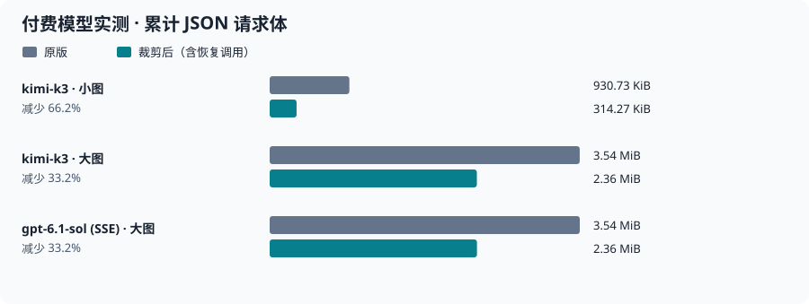

# pi-image-context-trimmer

[English](README.md) | 简体中文

Pi 图片上下文裁剪扩展：将已完成轮次的历史图片替换为可恢复引用，减少无状态模型接口的重复请求体和带宽负担。

## 安装

已在 Pi 1.6.0 验证，默认针对支持图片的 `openai-completions` 和 `openai-responses` API。

```sh
pi install npm:pi-image-context-trimmer
```

从源码试用（无需修改全局设置）：

```sh
git clone https://github.com/yoonshilee/pi-image-context-trimmer.git
cd pi-image-context-trimmer
npm ci --ignore-scripts
npm run check
pi -e ./src/index.ts
```

交互界面中输入 `/image-context-trimmer status` 查看本会话的适用状态、替换次数和省略的 Base64 体积；`/image-context-trimmer off` 恢复未经本扩展裁剪的请求，`/image-context-trimmer on` 重新开启。

SDK 可通过 `DefaultResourceLoader` 的 `additionalExtensionPaths` 加载扩展。对于明确使用 `transport: "sse"` 的 Codex SDK 宿主，可在 `extensionFactories` 中使用 `pi => imageContext(pi, { codexTransport: "sse" })` 显式开启裁剪；必须与宿主的 SSE 配置一致。默认 CLI 不裁剪 Codex 的原生 `auto` / WebSocket 路径。如果调用方明确禁用了工具或没有启用 `recall_context_image`，扩展不裁剪图片。只使用 `pi-agent-core`（没有 `pi-coding-agent` 扩展宿主）的程序需要自行接入 `src/image-context.ts` 的请求上下文转换与图片查找逻辑。

## 请求处理

1. 首次出现且可见于当前会话分支的用户图片或工具结果图片，按 Pi 原本的格式提交。
2. 图片后出现正常完成的模型回复或工具调用后，后续请求将较长的历史图片块替换为带 SHA-256 标识的短文本。新图片仍然发送；同一请求内完全相同的新图只需发送一次。
3. 模型需要精确视觉信息时调用 `recall_context_image`，扩展在当前会话分支查找原始图片并返回。下一次模型请求包含该图片，之后恢复引用形式。Pi 仍可按当前模型限制处理工具结果图片。
4. 原始会话消息不被扩展修改。没有可恢复来源、工具未启用或模型不支持图片时，保留图片。首次图片还未得到正常回复时，保留至少一份图片。Codex 的 WebSocket 增量续传以及其他未经验证的模型接口 不执行本扩展裁剪。

扩展不将图片上传到外部存储、不更改 Pi 源码、不改变会话文件格式，也不清理会话文件中的 Base64。模型仍可能需要额外的工具调用才能回答旧图的细节问题；上下文前缀改变也可能影响模型侧的提示词缓存。命令中的省略体积是上下文内 Base64 字符数，不是网络抓包字节数。

## 单张图片的体积

Pi 1.6.0 已支持在 `models.json` 的模型配置或 `modelOverrides` 中通过 `inputLimits.images.resize` 限制新图的分辨率、编码体积和 JPEG 质量。例如，针对需要节省流量的模型可配置：

```json
{
  "inputLimits": {
    "images": {
      "resize": {
        "maxWidth": 1568,
        "maxHeight": 1568,
        "maxBytes": 524288,
        "jpegQuality": 75
      }
    }
  }
}
```

这是示例参数而非扩展的默认配置。`maxBytes` 计算 Base64 编码体积；Pi 文档默认值为 2000 × 2000 像素、4.5 MiB 编码体积和 JPEG 质量 80。缩小图像可能损失文字、截图或图表细节，不应在没有识别需求验证的情况下全局强制使用。已有历史图片不会因该配置自动重编码。

## 本地验证

`npm run check` 执行类型检查、纯函数测试和 Pi 1.6.0 SDK 集成测试。集成测试加载实际扩展文件，在本地 HTTP 服务接收 Chat Completions 请求，不调用真实模型或外部网关。另使用 Pi 的两种兼容 API 序列化器，将请求交给本地模拟 `fetch`，测量不同大小模拟图像的 JSON 请求体。

已验证的有效 PNG 场景：原版三次调用每次收到图片 `[1, 1, 1]`；无需复看时，扩展三次调用收到 `[1, 0, 0]`；需要复看时，包含一次额外工具调用的四次请求收到 `[1, 0, 1, 0]`。会话保留原图。

1 MiB 模拟二进制图像编码后约 1.33 MiB。连续三次 Chat Completions 请求的序列化结果分别为原版 1,398,298、1,398,383、1,398,468 字节；扩展 1,398,298、456、541 字节（该测试不计工具定义和 Pi 默认系统提示词）。此处是本地序列化验证，不代表真实模型延迟或计费。

## 真实模型测试（2026-11-27）

以下结果来自 `gpt-6.1-sol` 与 `kimi-k3` 的三组完整对照，以及一次 GPT 原生增量传输验证。

### 测试方法

- 使用两个可重复生成的合成 PNG：`small`（480 × 290、237,304 字节）与 `large`（960 × 600、925,985 字节）。图片上、下分别放置不同四位数字；固定随机噪声背景用于形成不同请求体积。每个使用同一个图片和问题的配对包含三轮：读取上方数字、纯文本算术、读取原图下方数字。
- 原版不加载裁剪插件，裁剪组加载实际扩展。每组从空会话开始，使用相同模型和提示词，并要求答案严格等于预设值。设置输出上限 512 token、thinking off，关闭 Agent 与模型接口的自动重试、会话自动上下文压缩及主动缓存预热。
- 请求体体积来自 Pi 的 `before_provider_request` 事件中 JSON 序列化后的 UTF-8 字节长度，包含真实系统提示、工具定义和额外模型请求；不是 TLS 网络抓包。耗时为从提交该轮用户问题到 Agent 完成该轮的时间，包含模型、网络和恢复工具等待。Token 为 Pi 从模型响应记录的 `totalTokens`，不等于实收账单。
- GPT 的 SSE 对照通过独立 SDK 会话临时指定 `transport: "sse"`，并显式启用裁剪；未修改全局 Pi 设置。另测默认 `auto` 路径的原生 WebSocket 增量行为，后者的 请求钩子 仍可见完整候选上下文，不能用其 JSON 体积当作实际 WebSocket 发送量。
- 配对汇总仅统计原版和裁剪组均完整完成三轮的试验。

### 累计请求体对照



| 模型 / 图片 | 原版请求体 | 裁剪后请求体 | 请求体减少 | 模型调用 原/裁 | 耗时 原/裁 | 正确题数 原/裁 | 恢复原图次数 |
|---|---:|---:|---:|---:|---:|---:|---:|
| kimi-k3 / small | 930.73 KiB | 314.27 KiB | **66.2%** | 3/3 | 34.94/27.49 s | 3/3 · 3/3 | 0 |
| kimi-k3 / large | 3.54 MiB | 2.36 MiB | **33.2%** | 3/4 | 49.56/53.29 s | 3/3 · 3/3 | 1 |
| gpt-6.1-sol (SSE) / large | 3.54 MiB | 2.36 MiB | **33.2%** | 3/4 | 19.71/44.10 s | 3/3 · 3/3 | 1 |
| **完整配对合计** | **7.98 MiB** | **5.03 MiB** | **36.9%** | 9/11 | 104.21/124.88 s | 9/9 · 9/9 | 2 |

### 分轮请求体和 Token

| 模型 / 图片 | 首图 原/裁 | 文本轮 原/裁 | 复看轮 原/裁 | 总 token 原/裁 |
|---|---:|---:|---:|---:|
| kimi-k3 / small | 309.85 KiB / 310.27 KiB | 310.23 KiB / 1.81 KiB | 310.64 KiB / 2.20 KiB | 1,780 / 1,821 |
| kimi-k3 / large | 1.18 MiB / 1.18 MiB | 1.18 MiB / 1.78 KiB | 1.18 MiB / 1.18 MiB | 3,510 / 4,187 |
| gpt-6.1-sol (SSE) / large | 1.18 MiB / 1.18 MiB | 1.18 MiB / 2.12 KiB | 1.18 MiB / 1.18 MiB | 2,616 / 3,184 |

### GPT SSE 压缩请求体

| Codex SSE 压缩体积（相同 zstd 算法） | 原版 | 裁剪后 | 减少 |
|---|---:|---:|---:|
| gpt-6.1-sol (SSE) / large | 2.65 MiB | 1.77 MiB | **33.2%** |

### GPT 原生 WebSocket 增量验证

| Codex 原生 auto 传输 | 题数 | WebSocket 全量请求 | WebSocket 增量请求 | SSE 回退次数 |
|---|---:|---:|---:|---:|
| gpt-6.1-sol / small | 3/3 | 1 | 2 | 0 |

### 结论

- 三组完整配对中，原版和裁剪组分别答对 9/9，累计 JSON 请求体从 7.98 MiB 降至 5.03 MiB（减少 36.9%）。这个小规模合成图实验不是通用视觉准确率估计。
- 不需要图片的第二轮从 310.23 KiB 或 1.18 MiB 降到约 1.78–2.12 KiB；当模型必须恢复原图时，仍需传输图片，因此三轮累计节省约 33.2% 而不是 66.2%。
- 恢复工具增加模型调用；实测某些配对总耗时和 token 反而上升。该插件主要解决上行请求体和网关解析负担，不承诺更快响应或更低模型账单。未对网关 CPU、内存、并发承载量或实际扣费进行测量。
- GPT 原生 `auto` 路径实测一次全量、两次增量请求，三题全部答对；已有原生优化时不启用本扩展。SSE 的压缩体积按 Pi 1.6.0 使用的 zstd level 3 算法计算，不含 HTTP/TLS 开销。

### 复现

合成图片与测试问题均可从仓库重建，图表由保存的请求大小、用量和答复记录生成。真实模型测试需要已配置的模型访问权限。请将以下环境变量设置为相应模型在本地 Pi 配置中的完整标识。

```sh
python3 benchmark/fixtures.py
# 仅运行已有配置的模型；下列命令会产生真实模型用量。
npm run benchmark:paid -- "${GPT_MODEL_ID:?请设置 GPT 模型标识}"
npm run benchmark:paid -- "${KIMI_MODEL_ID:?请设置 Kimi 模型标识}"
# 单独验证原生增量传输，不开启裁剪。
npm run benchmark:paid -- --fixture=small --codex-auto "$GPT_MODEL_ID"
# 根据已保存的 JSON 重建图表和 Markdown 表格（不调用模型）。
python3 benchmark/report.py
```

普通 `npm run check` 不会发起付费模型调用。

## 许可证

[MIT](LICENSE)。
